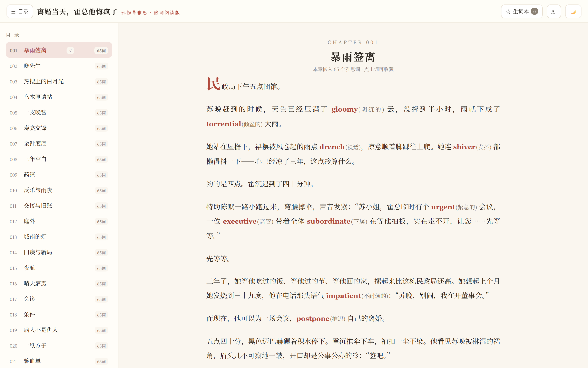
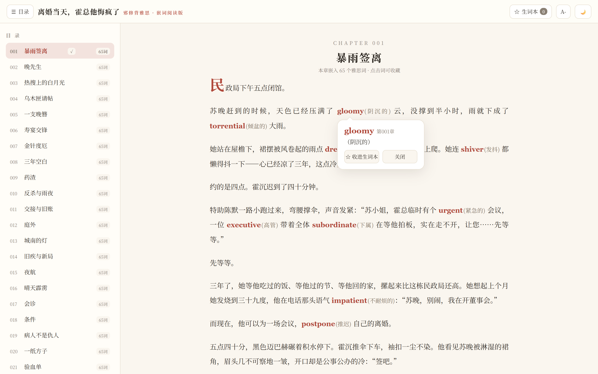
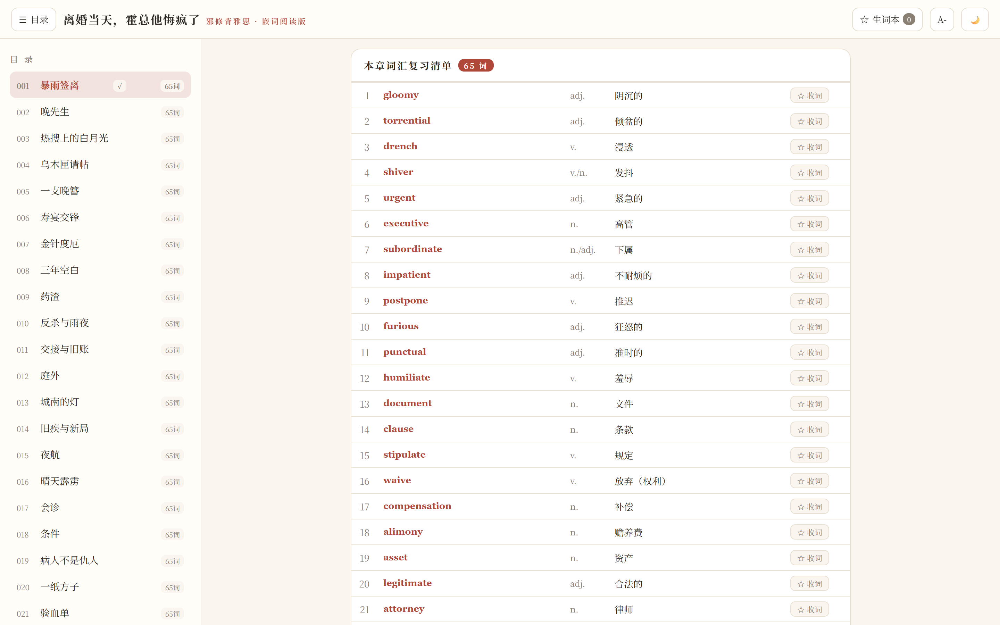
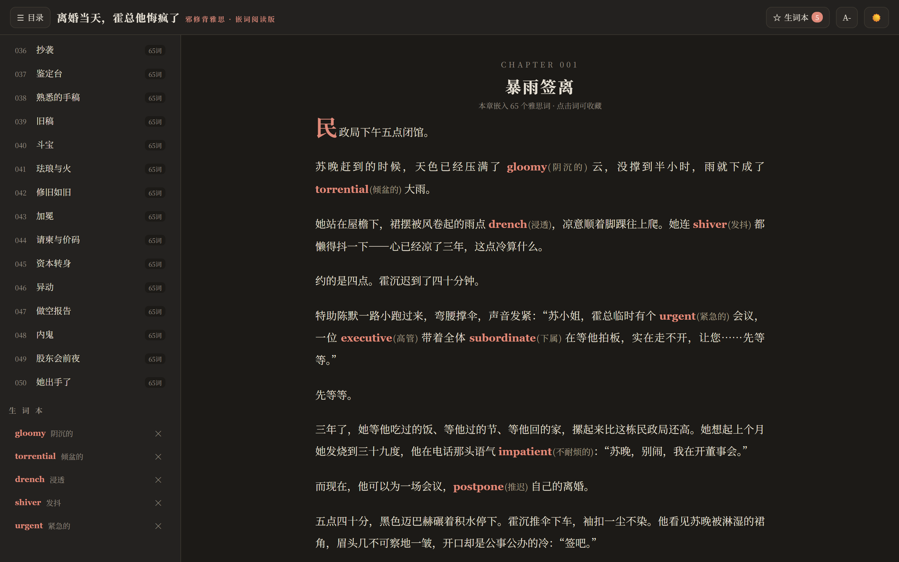

# 离婚当天，霍总他悔疯了 · 邪修背雅思

把雅思词汇嵌进都市爽文里的「嵌词阅读器」：读狗血剧情，顺手把单词背了。

正文每出现一个雅思词，都写成 `中文叙述 **English** (中文释义)` 的形式；点一下单词就能看词汇卡、收进生词本，章末还有一份完整复习清单。

**当前进度：50 章 / 3250 词（卷一 ~ 卷四），暂停更新。**



<table>
  <tr>
    <td width="50%"><br><sub>点词即看词汇卡，可一键收进生词本</sub></td>
    <td width="50%"><br><sub>章末复习清单：单词 / 词性 / 释义 / 收词</sub></td>
  </tr>
  <tr>
    <td width="50%" colspan="2"><br><sub>深色模式 + 生词本，进度与收藏都保存在本地</sub></td>
  </tr>
</table>

## 快速开始

单文件、零依赖，直接双击打开即可：

```
雅思爽文阅读器.html
```

或用任意静态服务器打开（截图与分享链接用这个更稳）：

```powershell
python -m http.server 8123
# 浏览器访问 http://127.0.0.1:8123/雅思爽文阅读器.html
```

## 功能

- **嵌词正文**：每个雅思词在正文中高亮，附中文释义，点击即可查看词汇卡
- **章末复习清单**：每章末尾列出全部单词，按序号 / 单词 / 词性 / 释义排成表格
- **生词本**：正文或清单里点「收词」即可收藏，随时在侧栏复习、移除
- **目录侧栏**：50 章标题 + 每章词数 + 已读标记（✓），点击直达
- **阅读设置**：字号四档切换、日间 / 夜间主题
- **本地记忆**：阅读进度、生词本、字号、主题全部存在 localStorage，关掉再开还在

## 项目结构

```
.
├── 雅思爽文阅读器.html        # 单文件阅读器：样式 + 50 章数据 + 交互逻辑
├── 大纲与设定.md              # 人物、9 卷剧情线、词汇域、写作规范
├── 词汇进度.md                # 逐章词汇进度追踪（章号 / 主题 / 词数 / 累计）
├── 正文/                      # 章节 Markdown 稿（目前仅第 001 章）
└── docs/screenshots/          # README 截图
```

## 进度

9 卷规划约 145 章、约 9400 词；已完成前 4 卷共 50 章，每章 65 词。

| 卷 | 章节 | 剧情线 | 雅思词汇域 | 状态 |
|---|---|---|---|---|
| 卷一 | 001–015 | 离婚篇：暴雨签字，净身出户 | 婚姻家庭 / 情感 / 法律基础 | ✅ 完成 |
| 卷二 | 016–030 | 神医马甲篇：「晚先生」出手救霍父 | 医疗健康 / 身体 / 疾病 | ✅ 完成 |
| 卷三 | 031–045 | 设计师马甲篇：国际珠宝大展惊艳全场 | 艺术设计 / 审美 / 材料工艺 | ✅ 完成 |
| 卷四 | 046–050 | 霍氏危机篇：做空与股东会决战 | 商业金融 / 经济 / 职场 | ✅ 完成 |
| 卷五 ~ 卷九 | 051–145 | 火葬场 / 学霸 / 生态园 / 商战复仇 / 大结局 | 心理情绪 / 教育科研 / 环境农业 / 科技法律 / 旅行文化 | ⏸ 未开始 |

逐章明细见 [词汇进度.md](词汇进度.md)。

## 写作规范

1. 每章正文 1200–2000 字，嵌入 60–70 个雅思词，不生僻超纲；
2. 单词首次出现时嵌正文：`**英文** (中文释义)`，一词只嵌一次；
3. 同卷词汇主题与剧情对应，让词「有语境、可推测」；
4. 章末附词汇复习清单表格；
5. 每章完成后在《词汇进度.md》登记词数与累计。

## 说明

- 故事、人物与文字均为原创，仅借用了常见的都市爽文套路。
- 词汇释义为备考向的简明中文，例句语境取自剧情，不替代词典。
- 项目已暂停在 50 章，后续卷五~卷九未写。
